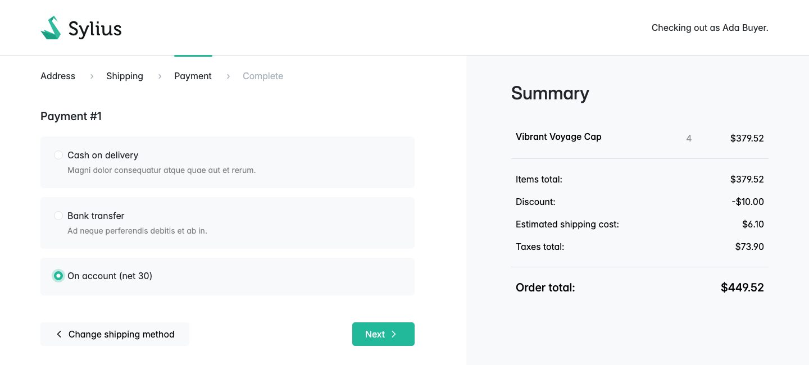
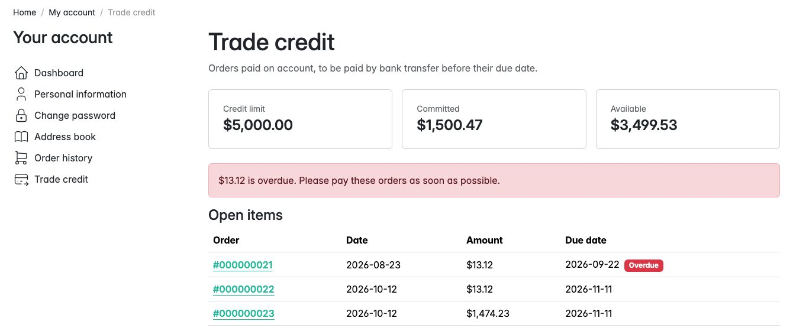
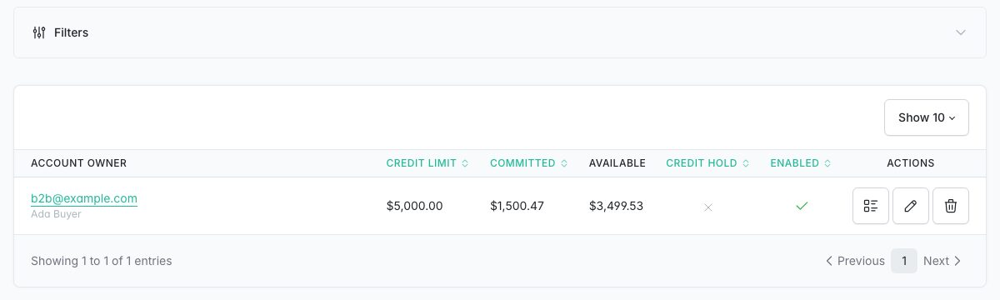
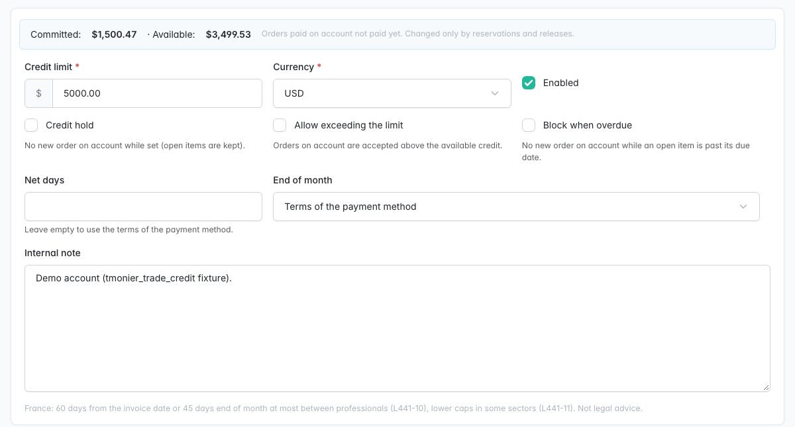
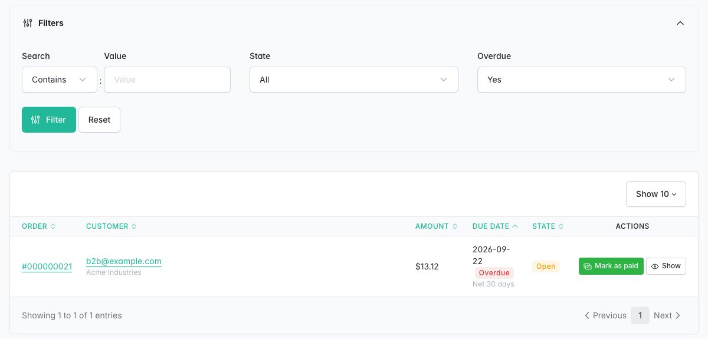
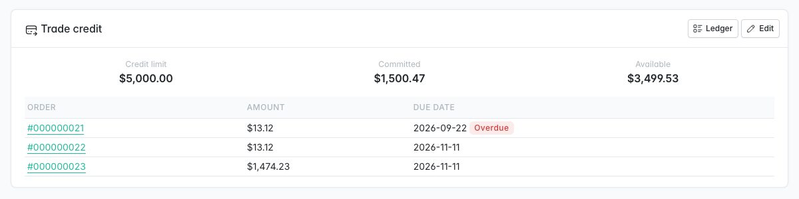

# Sylius Trade Credit Plugin

> English: [README.md](README.md) <!-- vitrine:lang -->

[](https://github.com/thibmonier/sylius-trade-credit-plugin/actions/workflows/build.yaml)
[](LICENSE)

**Crédit client B2B pour Sylius 2 : permettez aux clients professionnels approuvés de payer sur compte (« net 30 »,
« 45 jours fin de mois ») dans la limite d'un plafond de crédit.**

Les acheteurs professionnels paient rarement par carte : ils commandent, reçoivent une facture et la règlent par virement
bancaire 30 ou 45 jours plus tard. Sylius peut déjà afficher un moyen de paiement « Offline », mais il ne sait pas
qui peut l'utiliser, combien il reste dû, quand l'échéance tombe, et sa tâche de commandes impayées annule
ces commandes au bout de 5 jours.

Ce plugin transforme un moyen de paiement Offline en véritable paiement sur compte : un compte de crédit
par client avec un plafond, des réservations effectuées de façon atomique dans le tunnel de commande, un relevé dans le
compte client, des pièces ouvertes et « Marquer payé » dans le back-office, des échéances et des
conditions de paiement dans les factures Factur-X. B2B uniquement : ce n'est pas du crédit à la consommation.

## Fonctionnalités

| Besoin | Ce que fait le plugin |
|---|---|
| Décider qui peut payer sur compte | **Compte de crédit client** par client (administration, page client) : plafond de crédit et devise, *blocage du crédit* (blocage manuel), *autoriser le dépassement du plafond*, *bloquer en cas de retard*, conditions propres ou conditions du moyen de paiement, note interne. |
| Proposer le « paiement sur compte » avec des conditions | **Conditions de paiement** sur un moyen de paiement Offline : nombre de jours net et mode fin de mois (*net N jours*, *N jours fin de mois*, *fin de mois + N jours*). La commande reste *en attente de paiement* : pas de nouvelle passerelle. |
| Afficher le moyen uniquement s'il est autorisé | Via [tmonier/sylius-order-hold-plugin](https://github.com/thibmonier/sylius-order-hold-plugin) : masqué dans les listes de moyens de la boutique et de l'API, jamais choisi comme moyen par défaut, refusé lors des changements de moyen et à la finalisation du tunnel de commande (avec un message lisible), lorsque le client n'a pas de compte, que la commande n'est pas facturée à une entreprise, que le compte est bloqué, qu'il a des pièces en retard (s'il les bloque) ou que le crédit disponible est insuffisant. |
| Ne jamais dépasser le plafond, même avec des commandes simultanées | **Réservation atomique** à la finalisation du tunnel de commande : `UPDATE ... SET committed = committed + :total WHERE ... AND (allow_exceed OR limit - committed >= :total)`. Un refus (une autre commande a utilisé le crédit entre-temps) est une redirection avec un message dans la boutique et un 422 dans l'API, jamais une erreur serveur. Passer une commande passée vers ou depuis le paiement sur compte réserve ou libère. |
| Libérer le crédit une fois, et une seule | La réservation est **soldée** lorsque le paiement est complété (payé), **libérée** lorsque la commande est annulée ou que le paiement échoue ou est annulé. Une réservation est clôturée exactement une fois quels que soient les événements (payé puis remboursé, annulation de commande en cascade sur le paiement...). |
| Conserver les commandes à 30 jours | Les commandes avec une réservation sont **exclues de `sylius:cancel-unpaid-orders`** (en SQL). |
| Pas de paiement par carte pour une commande sur compte | La page de paiement de la boutique affiche la page de remerciement avec la date d'échéance ; l'API de la boutique refuse les demandes de paiement (les clients ne peuvent pas démarrer, compléter ni rembourser leur propre paiement). |
| Savoir ce que doit chaque client | Page **Relevé** dans le compte client (plafond, engagé, disponible, pièces ouvertes avec commande, échéance, indicateur de retard, lien vers la facture PDF avec sylius/invoicing-plugin) et **API boutique** en lecture seule `GET /api/v2/shop/trade-credit/statement`. |
| Encaisser les paiements | Grille d'administration des **pièces ouvertes** (filtres d'état et *en retard*, recherche par numéro de commande ou e-mail) avec **Marquer payé** (transition `complete` du `sylius_payment` du cœur : les écouteurs de facturation s'exécutent comme pour n'importe quel paiement), **registre** de chaque mouvement par compte. |
| Rester dans le cadre de la loi | Avertissements lorsque les conditions dépassent 60 jours ou 45 jours fin de mois (France, L441-10 ; limites par canal pour les plafonds sectoriels de L441-11). |
| Factures Factur-X | Avec [tmonier/sylius-facturx-plugin](https://github.com/thibmonier/sylius-facturx-plugin) 1.1 : date d'échéance (BT-9) et conditions de paiement (BT-20) de la commande, avec les mentions des pénalités de retard et de l'indemnité forfaitaire de recouvrement de 40 EUR. |
| Détecter les dérives | `tmonier:trade-credit:recalculate` compare les montants engagés avec les pièces ouvertes (simulation ; `--apply` corrige et journalise un ajustement). |
| Enregistrer les virements en masse *(1.1)* | `tmonier:trade-credit:import-payments payments.csv` solde les pièces ouvertes d'un fichier CSV (numéro de commande + montant, correspondance exacte) : simulation par défaut, **tout ou rien** (une ligne erronée et rien n'est soldé), **idempotent** (une commande déjà payée est signalée et ignorée, jamais soldée deux fois). |
| Relancer les clients *(1.1)* | `tmonier:trade-credit:send-reminders` (cron quotidien) : relances par e-mail avant et après l'échéance, à des niveaux configurables (par défaut 5 jours avant, 1, 15 et 30 jours après), **une par pièce ouverte et par niveau**, dans la locale de la commande (7 langues), avec les mentions de retard de paiement L441-10 une fois l'échéance dépassée. |
| Voir l'ancienneté de la dette *(1.1)* | **Tranches d'ancienneté** (non échu, 1-30, 31-60, 61-90, plus de 90 jours) sur le relevé, dans l'API boutique, sur la fiche client et pour tous les comptes au-dessus de la grille des pièces ouvertes. |
| Utiliser la position de crédit de votre ERP *(1.1)* | `ExternalCreditProviderInterface` : un ERP peut fournir le plafond de crédit et le montant dû en dehors de la boutique ; le paiement sur compte les utilise alors (échec fermé lorsque l'ERP est injoignable). Par défaut : chiffres Sylius uniquement. |

Également inclus : fixture de démonstration, traductions en anglais, français, allemand, espagnol, italien, néerlandais
et polonais, Twig Hooks, prise en charge de MySQL, MariaDB et PostgreSQL.

## Captures d'écran













## Prérequis

| | Version |
|---|---|
| PHP | 8.2+ (8.3+ avec Sylius 2.3) |
| Sylius | 2.2.9+, 2.3 |
| Symfony | 6.4, 7.4 (Sylius 2.2) ; 6.4, 7.4, 8.0 (Sylius 2.3) |
| tmonier/sylius-order-hold-plugin | 1.0 (installé comme dépendance) |

Les graphes du tunnel de commande, de la commande et du paiement doivent utiliser l'adaptateur Symfony Workflow (valeur par
défaut de Sylius 2) ; order-hold le vérifie à la compilation du conteneur. Sylius 2.2.9 est la première version 2.2
avec les correctifs de GHSA-2rv4-pjmm-7fxf et GHSA-vv4h-q2x8-74g4 (demandes de paiement).

## Installation

1. Requérez le paquet :

    ```bash
    composer require tmonier/sylius-trade-credit-plugin
    ```

2. Enregistrez les deux bundles dans `config/bundles.php` :

    ```php
    Tmonier\SyliusOrderHoldPlugin\TmonierSyliusOrderHoldPlugin::class => ['all' => true],
    Tmonier\SyliusTradeCreditPlugin\TmonierSyliusTradeCreditPlugin::class => ['all' => true],
    ```

3. Importez la configuration et les routes :

    ```yaml
    # config/packages/tmonier_sylius_trade_credit.yaml
    imports:
        - { resource: "@TmonierSyliusTradeCreditPlugin/config/config.yaml" }
    ```

    ```yaml
    # config/routes/tmonier_sylius_trade_credit.yaml
    tmonier_sylius_trade_credit:
        resource: "@TmonierSyliusTradeCreditPlugin/config/routes.yaml"
    ```

4. Exécutez la migration (tables du plugin uniquement, les tables du cœur ne sont pas modifiées) :

    ```bash
    bin/console doctrine:migrations:migrate
    ```

5. Dans l'administration : créez un moyen de paiement **Offline** (par exemple « On account (net 30) »), puis
   *Clients > Conditions de paiement > Créer* pour celui-ci ; ouvrez un compte de crédit client depuis la page
   client de chaque client professionnel approuvé.

## Configuration

Facultative, avec les valeurs par défaut :

```yaml
tmonier_sylius_trade_credit:
    legal_limits:
        net_days: 60            # warning above 60 days from the invoice date
        end_of_month_days: 45   # warning above 45 days end of month
        channels:               # per channel code, e.g. a sector cap (L441-11)
            WHOLESALE: { net_days: 30, end_of_month_days: 30 }
    reminders:
        levels: [-5, 1, 15, 30] # days relative to the due date (negative: before); [] disables them
```

Une politique de conditions de paiement est vérifiée par rapport aux plafonds des canaux de son moyen de paiement ; un
compte avec ses propres conditions, par rapport au plafond configuré le plus strict.

### Relances de paiement

Exécutez `bin/console tmonier:trade-credit:send-reminders` une fois par jour (`--dry-run` les liste). Pour
chaque pièce ouverte (et chaque commande restée impayée après avoir quitté le paiement sur compte), seul le niveau
le plus élevé atteint est envoyé, une seule fois : un niveau est enregistré avant l'envoi de l'e-mail (unique par commande,
échéance et niveau), si bien qu'exécuter la commande deux fois, ou deux exécutions simultanées, n'envoie jamais
une relance deux fois ; un e-mail en échec est envoyé par l'exécution suivante. L'e-mail
(`tmonier_trade_credit_payment_reminder`, template
`@TmonierSyliusTradeCreditPlugin/email/payment_reminder.html.twig`) est adressé au client de
la commande, dans la locale de la commande, avec un lien vers le relevé lorsque le canal a un nom d'hôte.

### Import CSV des paiements

```csv
order_number;amount;currency
000000021;13.12;EUR
000000022;1 312,50;EUR
```

Une ligne d'en-tête avec `order_number` et `amount` (décimal, `.` ou `,`), `currency` facultative ;
les autres colonnes (référence bancaire, date...) sont ignorées ; séparateur `,`, `;` ou tabulation. Chaque ligne doit
correspondre exactement à une pièce ouverte (numéro de commande, montant, devise). Exécutez-le d'abord sans `--apply` :

```bash
bin/console tmonier:trade-credit:import-payments payments.csv           # dry run
bin/console tmonier:trade-credit:import-payments payments.csv --apply   # settles, all or nothing
```

Le règlement équivaut à « Marquer payé » (transition `complete` du `sylius_payment` du cœur).

### Fournisseur de crédit externe (ERP)

```php
use Tmonier\SyliusTradeCreditPlugin\Credit\ExternalCreditPosition;
use Tmonier\SyliusTradeCreditPlugin\Credit\ExternalCreditProviderInterface;
use Tmonier\SyliusTradeCreditPlugin\Entity\TradeCreditAccountInterface;

final class ErpCreditProvider implements ExternalCreditProviderInterface
{
    public function getPosition(TradeCreditAccountInterface $account): ?ExternalCreditPosition
    {
        // Amounts in minor units. Null: Sylius figures only for this account.
        return new ExternalCreditPosition(creditLimit: 5_000_00, externalCommittedAmount: 1_200_00);
    }
}
```

```yaml
# config/services.yaml
Tmonier\SyliusTradeCreditPlugin\Credit\ExternalCreditProviderInterface: '@App\Credit\ErpCreditProvider'
```

Le plafond de l'ERP (lorsqu'il n'est pas null) remplace le plafond du compte et le montant dû en dehors
de la boutique réduit le crédit disponible, dans les listes de moyens de paiement et dans la réservation atomique. Si
le fournisseur lève une exception (ERP injoignable), le paiement sur compte est refusé avec « temporairement
indisponible » (échec fermé) et le relevé affiche les chiffres Sylius. Appelé à chaque contrôle
d'éligibilité : mettez-le en cache dans votre fournisseur si l'ERP est lent.

Les ressources (`account`, `payment_terms_policy`, `order_payment_terms`, `ledger_entry`) peuvent être
surchargées comme n'importe quelle ressource Sylius (`tmonier_sylius_trade_credit.resources.account.classes.model`, ...).

## Fonctionnement

- **Qui peut payer sur compte** : le moyen de paiement a une politique de conditions de paiement activée, la
  commande est passée par son **client connecté** (jamais en commande invité, même avec l'e-mail d'
  un client ayant un compte : ces commandes reçoivent un refus générique qui ne révèle rien), le
  propriétaire de la commande (order-hold `AccountOwnerResolverInterface` : le client, une entreprise une fois qu'un
  plugin d'entreprise le décore) a un compte activé dans la devise de la commande, l'**adresse de facturation
  comporte un nom d'entreprise** (contrôle B2B), le compte n'est pas bloqué, n'a aucune pièce ouverte en retard
  lorsqu'il les bloque, et le crédit disponible couvre le total de la commande (sauf si le dépassement
  est autorisé). Les comptes sont ouverts par le personnel, qui vérifie le client. Une commande qui a quitté
  le paiement sur compte (passée à un moyen qui n'est pas sur compte, paiement échoué) et qui est toujours
  impayée après son échéance compte encore comme en retard : elle est listée comme en retard sur le relevé,
  la fiche client et les pièces ouvertes de l'administration (où elle peut être marquée payée). Passer à
  un autre moyen sur compte n'est pas une sortie : les nouvelles conditions s'appliquent.
- **Désactiver ou supprimer des conditions de paiement** : une politique désactivée refuse son moyen (il ne
  devient jamais un simple moyen Offline pour tout le monde) ; les pièces ouvertes restent soldables, car la clôture est
  pilotée par la réservation, pas par la politique actuelle. Une politique avec des pièces ouvertes ne peut être
  ni supprimée ni déplacée vers un autre moyen.
- **Conditions** : les jours nets du compte lorsqu'ils sont définis (avec son propre mode fin de mois, sinon celui de
  la politique), sinon ceux de la politique. L'échéance est calculée à partir de la date de finalisation du tunnel de commande et
  figée avec le montant réservé. Une nouvelle réservation de la même commande (après un paiement échoué
  ou un changement de moyen) ne redémarre jamais les conditions : même échéance avec le même moyen, même date
  de départ avec un autre moyen sur compte.
- **États d'une pièce ouverte** : *ouverte* (réservée) → *payée* (soldée) ou *libérée*. Le montant
  engagé ne change en SQL que par ces transitions ; chaque changement est une écriture du registre.
- **Remboursements** : un remboursement n'intervient qu'après qu'un paiement a été complété, donc le crédit était déjà
  libéré : rien ne change.

## Personnalisation

| Hook | Contenu |
|---|---|
| `sylius_admin.customer.show.content.sections` → `tmonier_trade_credit` | Fiche de crédit client de la page client |
| `tmonier_trade_credit_admin.account.{create,update}.content.form.sections.general` → `fields` | Formulaire du compte |
| `tmonier_trade_credit_admin.payment_terms_policy.{create,update}.content.form.sections.general` → `fields` | Formulaire des conditions de paiement |
| `tmonier_trade_credit_admin.open_item.index.content` → `ageing` | Ancienneté de chaque compte au-dessus de la grille des pièces ouvertes |

Services : `tmonier_trade_credit.reserver` (seul à écrire les montants engagés),
`tmonier_trade_credit.provider.account`, `tmonier_trade_credit.order_hold.eligibility_checker`
(peut être décoré pour ajouter des règles), `tmonier_trade_credit.facturx.payment_terms_provider`.

## Données de démonstration

La fixture `tmonier_trade_credit` (ajoutez-la à une suite de fixtures) crée le moyen « On account (net 30) »
et sa politique, le client B2B vérifié `b2b@example.com` / `sylius` (entreprise « Acme
Industries », plafond de 5 000,00) avec deux commandes sur compte, dont une en retard, et vérifie les
utilisateurs de la boutique des fixtures (le canal de démonstration exige un compte vérifié pour se connecter).

## Limitations

- **Une seule devise** par compte (la devise de base du canal) ; pas de paiements partiels : une pièce
  ouverte est payée en totalité avec « Marquer payé ».
- Pas de calcul d'intérêts, pas d'affectation d'un virement à plusieurs commandes (une ligne CSV par
  commande), pas de relevés bancaires CAMT/MT940, pas d'export comptable. Pas de frais ni de majorations.
- L'import des paiements est une commande console (pas de formulaire d'envoi dans l'administration).
- Les relances sont des e-mails adressés uniquement au client de la commande (pas de copie à l'entreprise ni au personnel).
- Une relance est enregistrée comme envoyée lorsque le mailer l'accepte : avec un transport Messenger
  asynchrone pour les e-mails, un envoi qui échoue plus tard dans le worker n'est pas renvoyé par la
  commande (routez `Symfony\Component\Mailer\Messenger\SendEmailMessage` de façon synchrone, ou
  appuyez-vous sur les nouvelles tentatives du transport et la file des échecs).
- Dans la boutique, la réservation (sa propre transaction SQL) et l'enregistrement de la commande finalisée sont
  deux étapes : si l'enregistrement de la commande échoue ensuite, la réservation laissée sur le panier est remplacée
  lorsque le tunnel de commande est de nouveau finalisé, et libérée au bout d'une heure par
  `tmonier:trade-credit:recalculate --apply` (exécutez-la depuis un cron quotidien ; elle verrouille chaque compte,
  donc elle est sûre pendant que les clients commandent). De même, si l'enregistrement d'un changement de moyen échoue après
  que la nouvelle réservation a été faite, payer la commande la solde quand même et la commande réserve
  de nouveau pour le moyen du paiement (ou libère). Dans l'API, la transaction du bus de commandes couvre les deux.
- Un nouveau paiement créé après un paiement échoué conserve le moyen sur compte et réserve de nouveau ; si
  le crédit n'est plus disponible, order-hold remplace le moyen par un moyen éligible, ou le
  paiement reste sans réservation et le client est invité à choisir un autre moyen.
- Une commande qui perd sa réservation (paiement échoué ou annulé, passée à un autre moyen)
  devient une commande impayée ordinaire : `sylius:cancel-unpaid-orders` compte sa période d'expiration
  à partir de cette libération.
- Avec un compte partagé (entreprise), le relevé liste les commandes des autres acheteurs sans
  lien ni facture (`placedByYou` à false dans l'API).
- Les avertissements juridiques ne constituent pas un conseil juridique et ne bloquent rien.
- Les administrateurs peuvent toujours modifier les moyens de paiement et compléter les paiements : les réservations suivent.

## Développement

```bash
docker compose up -d mysql mailhog   # host ports in compose.override.yml (gitignored)
composer database-reset              # dev database with fixtures (APP_ENV=test for the test one)
vendor/bin/phpunit                   # every suite once (unit, integration, functional)
vendor/bin/phpstan analyse
vendor/bin/ecs check
```

Voir [SPEC.md](SPEC.md) pour la recherche et les décisions de conception.

<!-- vitrine:demo-b2b:start -->
## Démo B2B

Ce plugin est utilisé dans la [démo B2B Sylius](https://github.com/thibmonier/sylius-b2b-demo) : une boutique Sylius 2.3 avec des données d'exemple fictives, où les plugins B2B fonctionnent ensemble. Le code source, l'installation et les fixtures de la démo sont dans ce dépôt.

La démo est un exemple, pas une configuration de production.
<!-- vitrine:demo-b2b:end -->

## Licence

MIT, voir [LICENSE](LICENSE).
